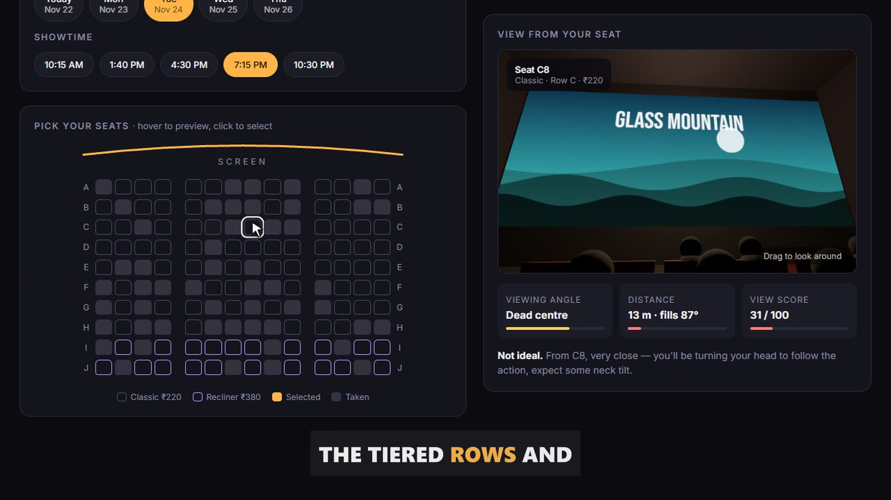

# Moview — see your seat before you book

A concept for movie ticket booking that shows you the **real view from every seat** before you pay for it.

Hover any seat on the map and a 3D theatre moves you into it: you see the screen at its true angle, the stadium rows, and the people already sitting in front of you. Every seat also gets a view score.



## Features

- **Live 3D seat preview** – the camera glides to the seat you hover, built with Three.js
- **Drag to look around** from any seat
- **Real obstructions** – taken seats show silhouettes, so you can see who might block your view
- **View score (0–100)** – based on how far off-centre you are, how much of your vision the screen fills, neck tilt, and the person in front
- **Plain-language verdict** – e.g. *"very close — you'll be turning your head to follow the action"*
- Movie, date and showtime picker, classic and recliner pricing, and a booking ticket at the end
- Responsive, no build step, one HTML file

## Run it locally

ES modules need a local server (opening the file directly won't load the 3D view):

```bash
npx http-server -p 5173 .
```

Then open http://localhost:5173.

## How the view score works

| Factor | Ideal |
| --- | --- |
| Horizontal angle to screen centre | as close to 0° as possible |
| How much of your field of view the screen fills | around 48° |
| Vertical neck tilt | under ~4° |
| Person in the seat in front | empty seat, or a big enough riser step |

## Tech

HTML, CSS, vanilla JavaScript and [Three.js](https://threejs.org/). Movies, prices and occupancy are mock data, and booking only happens in the browser.

## License

MIT
